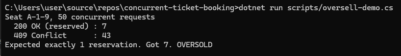
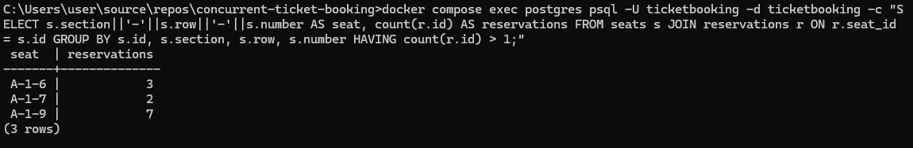
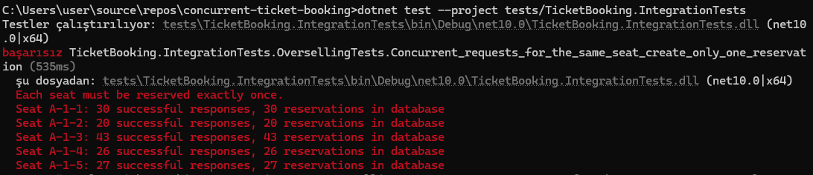
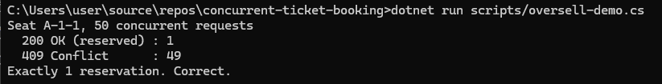
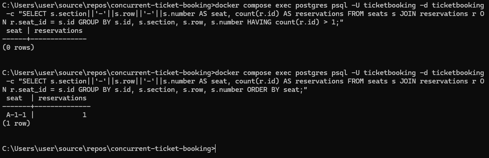
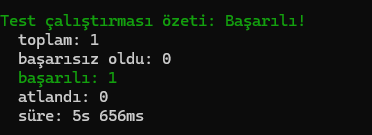

# Chapter 1 — Overselling

> **Problem:** two (or forty-three) people are told they bought the same seat.
> **Fix:** optimistic concurrency with PostgreSQL's `xmin` row version.
> **Tags:** [`ch1-broken`](https://github.com/meteyilmaz01/concurrent-ticket-booking/tree/ch1-broken) → [`ch1-fixed`](https://github.com/meteyilmaz01/concurrent-ticket-booking/tree/ch1-fixed)

[← Back to README](../../README.md)

## The scenario

Tickets for a concert go on sale. Many people click on the same seat within the same few milliseconds. Exactly one of them should get it; everyone else should be told the seat is taken (`409 Conflict`).

## The intentionally broken code

[`ReservationService.ReserveSeatAsync`](../../src/TicketBooking.Application/Services/ReservationService.cs) follows the most natural pattern there is: **read → check → write**.

```csharp
// 1) Read the seat
var seat = await _seatRepository.GetByIdAsync(request.SeatId);
if (seat == null)
{
    throw new NotFoundException("Seat not found.");
}

// 2) Check it is free (a hold that has expired counts as free)
var isFree = seat.Status == SeatStatus.Available
    || (seat.Status == SeatStatus.Held && seat.HoldExpiresAtUtc <= now);

if (!isFree)
{
    throw new ConflictException("Seat is not available.");
}

// 3) Write: hold the seat for 10 minutes and create the reservation
seat.Status = SeatStatus.Held;
seat.ReservationId = reservation.Id;
seat.HoldExpiresAtUtc = reservation.ExpiresAtUtc;

await _reservationRepository.AddAsync(reservation);
await _reservationRepository.SaveChangesAsync();
```

### Why it looks correct

There is a null check, a clear business rule, expired holds are handled, and everything is saved with a single `SaveChangesAsync`. It would pass most code reviews.

Testing it by hand also looks fine. Requests sent one after another behave perfectly:

```
Request 1 → 200 OK        (seat reserved)
Request 2 → 409 Conflict  (seat is not available)
```

### What actually goes wrong

The gap between step 1 and step 3 is only a few milliseconds, but under load other requests arrive inside it:

```
Request A                                 Request B
─────────                                 ─────────
1) SELECT seat   → Available
                                          1) SELECT seat   → Available
2) check: free ✔
                                          2) check: free ✔
3) UPDATE seats SET status = 'Held' ...
   INSERT INTO reservations (A) ...
                                          3) UPDATE seats SET status = 'Held' ...
                                             INSERT INTO reservations (B) ...
→ 200 OK                                  → 200 OK
```

Both requests saw an available seat, both passed the check, both saved. The `UPDATE` only says `WHERE id = @seatId`, so nothing in the database notices that the seat changed in between. The seat row keeps only the last reservation id; every other buyer was silently overwritten, but still got `200 OK` and a reservation row.

## Proof

### Demo script: 50 concurrent requests for one seat

[`scripts/oversell-demo.cs`](../../scripts/oversell-demo.cs) picks a free seat and sends 50 reservation requests for it at the same time.



**7 people** were told they reserved seat A-1-9.

### Database: the damage is real

```sql
SELECT s.section || '-' || s.row || '-' || s.number AS seat,
       count(r.id) AS reservations
FROM seats s
JOIN reservations r ON r.seat_id = s.id
GROUP BY s.id, s.section, s.row, s.number
HAVING count(r.id) > 1;
```



The results are not just wrong API responses; the reservations are stored. The numbers also change from run to run, and sometimes a run shows no problem at all. "I tried it a few times and it was fine" is not evidence that concurrent code is correct.

### Integration test

[`OversellingTests`](../../tests/TicketBooking.IntegrationTests/OversellingTests.cs) starts a throwaway PostgreSQL with Testcontainers, runs the API in memory and, for each of 5 seats, prepares 50 requests and releases them **together** with a start signal. It expects exactly one successful response and exactly one reservation row per seat.



| Seat | Successful responses | Reservations in database |
|---|---|---|
| A-1-1 | 30 | 30 |
| A-1-2 | 20 | 20 |
| A-1-3 | **43** | **43** |
| A-1-4 | 26 | 26 |
| A-1-5 | 27 | 27 |

Out of 50 people asking for seat A-1-3, 43 were told it was theirs.

## A tempting wrong fix: "just add a transaction"

```csharp
using var transaction = await _context.Database.BeginTransactionAsync();
// read → check → write
await transaction.CommitAsync();
```

This does **not** prevent overselling. PostgreSQL's default isolation level is Read Committed: both transactions can still read the seat as `Available`. When the second `UPDATE ... WHERE id = @seatId` runs, it waits for the first transaction to commit and then simply updates the row again, because its `WHERE` clause does not care about the seat's state. A transaction guarantees "all or nothing", not "nobody else can read this at the same time".

## The fix: optimistic concurrency

PostgreSQL keeps a hidden version for every row in the system column `xmin`, and changes it automatically every time the row is updated. The fix tells EF Core to use that version when saving a seat.

**1. A version property on the seat** ([`Seat.cs`](../../src/TicketBooking.Domain/Entities/Seat.cs)):

```csharp
public uint Version { get; set; }
```

**2. Map it to `xmin`** ([`SeatConfiguration.cs`](../../src/TicketBooking.Infrastructure/Persistence/Configurations/SeatConfiguration.cs)):

```csharp
builder.Property(s => s.Version).IsRowVersion();
```

**3. Turn the concurrency error into a 409** ([`ReservationRepository.cs`](../../src/TicketBooking.Infrastructure/Repository/ReservationRepository.cs)):

```csharp
try
{
    await _context.SaveChangesAsync();
}
catch (DbUpdateConcurrencyException)
{
    throw new ConflictException("Seat is not available.");
}
```

`ReserveSeatAsync` itself is **unchanged**. Its comment still explains the original bug, followed by how it was fixed.

### What changed in the SQL

```sql
-- Before
UPDATE seats SET status = 'Held', reservation_id = ...
WHERE id = @seatId

-- After
UPDATE seats SET status = 'Held', reservation_id = ...
WHERE id = @seatId AND xmin = @versionReadInStep1
```

"Update this seat, **but only if nobody has changed it since I read it.**"

### The same race, now

The seat starts at version 100:

```
Request A                                 Request B
─────────                                 ─────────
1) SELECT seat   → Available, v100
                                          1) SELECT seat   → Available, v100
2) check: free ✔
                                          2) check: free ✔
3) UPDATE ... WHERE xmin = 100
   → 1 row updated ✔
   → PostgreSQL sets the version to v101
                                          3) UPDATE ... WHERE xmin = 100
                                             → seat is now v101
                                             → 0 rows updated ❌
→ 200 OK                                  → 409 Conflict
```

Steps 1 and 2 still behave exactly as before; both requests still see a free seat. The difference is step 3: only the first write succeeds, and the database rejects the second because what it read is out of date.

`SaveChangesAsync` sends the seat update and the reservation insert in one transaction. When the update affects 0 rows, EF Core rolls back the whole transaction, so the losing request leaves **no** reservation behind.

The 49 losing requests fail in one of two places, with the same `409` response:

- requests that read the seat after the winner saved see `Held` and fail the check in step 2;
- requests that read it at the same time as the winner pass the check, then fail the version check in step 3. These are exactly the requests that used to oversell.

The [`AddSeatVersion`](../../src/TicketBooking.Infrastructure/Persistence/Migrations/) migration adds no column, because `xmin` already exists on every PostgreSQL table; it only records the model change.

## After the fix

### Demo script



### Database



### Integration test



| | Broken | Fixed |
|---|---|---|
| Successful reservations per seat (50 requests) | 20 – 43 | 1 |
| Seats with more than one reservation | all tested seats | none |
| Integration test | ❌ fails | ✅ passes (consistently) |

## Alternatives considered

| | Optimistic concurrency (chosen) | Pessimistic lock | Atomic conditional `UPDATE` |
|---|---|---|---|
| Idea | Save only if the row version is unchanged | `SELECT ... FOR UPDATE` locks the seat; others wait | `UPDATE ... WHERE status = 'Available'` does check and write in one statement |
| Code change | Smallest: one property, one mapping, one `catch` | Largest: locked read plus an explicit transaction around read and write | Medium: the "is it free?" rule moves into the query |
| Do requests wait? | No | Yes, in a queue | Very briefly |
| Under heavy load | Good | Slows down; each waiting request holds a connection | Best |

Optimistic concurrency was chosen because it is the smallest and most readable change, it is EF Core's standard mechanism, and the business code stays exactly as it was. In a ticketing system, a request that loses the race should get `409` anyway, so the "wasted" attempts cost nothing extra.

Because the check happens in the database, not in the application's memory, it also holds when several API instances run at the same time. That matters in [Chapter 2](../../README.md#chapters).

## Try it yourself

```bash
git checkout ch1-broken
dotnet test --project tests/TicketBooking.IntegrationTests   # fails: seats are oversold

git checkout ch1-fixed
dotnet test --project tests/TicketBooking.IntegrationTests   # passes
```

Docker must be running. See [Getting started](../../README.md#getting-started) for running the API and the demo script.
