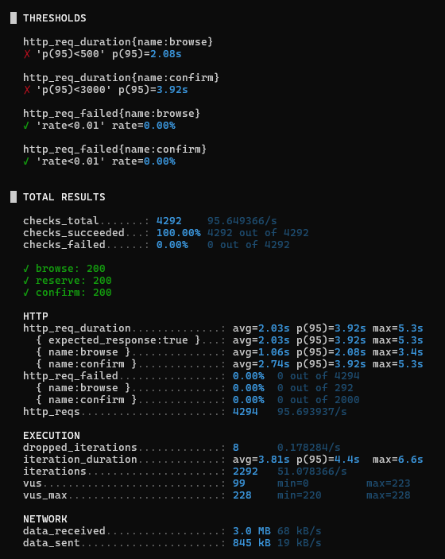
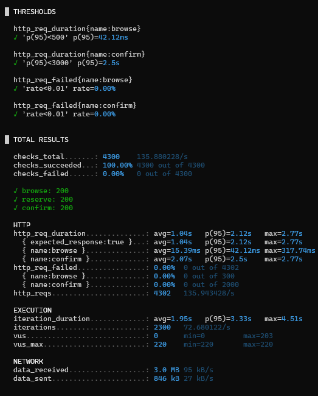

# Chapter 2 — Payment inside a database transaction

> **Problem:** while people are paying, even the event list becomes slow.
> **Fix:** call the payment provider without holding a database transaction.
> **Tags:** [`ch2-broken`](https://github.com/meteyilmaz01/concurrent-ticket-booking/tree/ch2-broken) → [`ch2-fixed`](https://github.com/meteyilmaz01/concurrent-ticket-booking/tree/ch2-fixed)

[← Back to README](../../README.md)

## The scenario

A user holds a seat and pays for it with `POST /api/reservations/{id}/confirm`. The payment provider takes about 2 seconds to answer. Many people pay at the same time, while others are only browsing events.

The provider in this project is [`TicketBooking.FakePaymentGateway`](../../src/TicketBooking.FakePaymentGateway/): a separate service that waits 2 seconds (configurable) and records each charge.

## The intentionally broken code

The intention is reasonable: "if the payment fails, nothing should be saved". So the whole confirmation goes into one transaction:

```csharp
await _reservationRepository.BeginTransactionAsync();   // a connection is taken here

var reservation = await _reservationRepository.GetByIdAsync(reservationId);
// ... checks ...
var seat = await _seatRepository.GetByIdAsync(reservation.SeatId);

var payment = await _paymentGateway.ChargeAsync(reservation.Id, reservation.TotalInKurus);   // ~2 s

// ... mark the reservation confirmed and the seat sold ...
await _reservationRepository.SaveChangesAsync();
await _reservationRepository.CommitAsync();             // and only given back here
```

### Why it looks correct

It works. A single confirmation takes about 2.3 seconds, almost all of it spent waiting for the provider, and a second confirmation of the same reservation gets `409 Conflict`. Nothing in a manual test hints at a problem.

### What actually goes wrong

A transaction keeps one database connection for itself from `BEGIN` to `COMMIT`. For 2 seconds that connection does nothing but wait for someone else's server.

Connections are limited: Npgsql's pool holds at most 100 by default. With 200 people paying at once, the pool is used up by requests that are not talking to the database at all. Every other request has to queue for a connection, including `GET /api/events`, which has nothing to do with payments.

## Proof

[`load-tests/payment-load.js`](../../load-tests/payment-load.js) is a [k6](https://k6.io/) test with two groups running at the same time:

- **buyers:** 200 users, each reserving and paying for 10 seats one after another (2,000 payments);
- **browsers:** 10 requests per second to the event list.

It defines what "healthy" means: the event list under 500 ms (p95), a payment under 3 s (p95), fewer than 1% failed requests.



No request failed, which is what makes this easy to miss: the system is **correct but slow**. The event list, which takes a few milliseconds on an idle system, took more than a second on average.

## The fix

Remove the transaction. Nothing else changes.

```csharp
var reservation = await _reservationRepository.GetByIdAsync(reservationId);
// ... checks ...
var seat = await _seatRepository.GetByIdAsync(reservation.SeatId);

var payment = await _paymentGateway.ChargeAsync(reservation.Id, reservation.TotalInKurus);   // no connection held

// ... mark the reservation confirmed and the seat sold ...
await _reservationRepository.SaveChangesAsync();
```

- Without an explicit transaction, EF Core opens a connection for each query and returns it to the pool right after. While the provider is working, the request holds none.
- A single `SaveChanges` is already atomic: the reservation and the seat are updated together or not at all.
- If the payment fails, an exception is thrown before anything is changed, so "a failed payment saves nothing" still holds.

The transaction methods on the repository had no other user and were removed.

## After the fix

The same test on the same machine:



| | Broken | Fixed |
|---|---|---|
| Event list, average | 1.06 s | **15 ms** |
| Event list, p95 | 2.08 s ❌ | **42 ms** ✅ |
| Payment, p95 | 3.92 s ❌ | **2.50 s** ✅ |
| Requests per second | 96 | 136 |
| Failed requests | 0% | 0% |

A payment cannot get much faster than 2 s, because that is how long the provider takes.

These numbers come from one run of each version on a development machine, with the API, database and load generator sharing it. Expect different absolute values elsewhere; the gap between the two versions is the point.

### A note on "too many clients"

During these tests, opening a `psql` session could fail with `FATAL: sorry, too many clients already`. This is **not** used as evidence here, because it also happens with the fixed version. Npgsql's default maximum pool size (100) equals PostgreSQL's default `max_connections` (100), so one busy API instance can take every slot. In a real deployment the pool size should be set below the server limit.

## What this fix does not solve

Charging money and saving to the database are two separate systems, and no database transaction can cover both. The broken version had these problems too, since a rollback cannot undo a charge:

- **Double charge:** two parallel confirmations of the same reservation both see it as pending and both charge. The row version from [Chapter 1](01-overselling.md) rejects the second save, but the money has already been taken.
- **Charged without a seat:** if the save fails after a successful charge (for example the hold expired during the payment and someone else took the seat), the customer pays and gets nothing.

The first is the subject of Chapter 3 (idempotency). The second needs a refund or reconciliation process, which is outside the scope of this project.

## Try it yourself

Start the database, the fake payment gateway and the API (see [Getting started](../../README.md#getting-started)), then:

```bash
docker compose run --rm k6 run /scripts/payment-load.js
```

Run it once at `ch2-broken` and once at `ch2-fixed`, restarting the API after each checkout.

Each run uses 2,000 of the 10,000 seats in the load test event. When the test reports that there are not enough free seats, reset the data:

```bash
docker compose exec postgres psql -U ticketbooking -d ticketbooking -c "DELETE FROM reservations; UPDATE seats SET status = 'Available', reservation_id = NULL, hold_expires_at_utc = NULL;"
```
